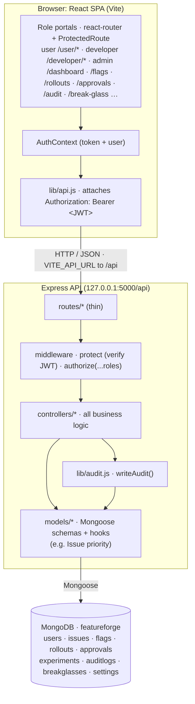

# FeatureForge

**Accountable change management for product teams.** FeatureForge pairs a feature-flag
governance platform with a crowd-sourced issue tracker on a single Express + MongoDB
backend and a React single-page app. Every state-changing action (assigning an issue,
approving a flag change, bypassing review in an incident, or an automatic rollback firing)
lands as an attributable, immutable entry in one audit trail.

<p>
  
  
  
  
  
  
</p>

## Contents

- [Overview](#overview)
- [Architecture](#architecture)
- [Tech stack](#tech-stack)
- [Project structure](#project-structure)
- [Getting started](#getting-started)
- [Seeded accounts](#seeded-accounts)
- [Roles & access control](#roles--access-control)
- [API reference](#api-reference)
- [Data models](#data-models)
- [Testing](#testing)
- [Demo](#demo)
- [Design notes & scope](#design-notes--scope)

## Overview

FeatureForge is two products that share one backend, one auth system, and one audit log.

### Feature-flag governance (admin)

- **Flags:** create, toggle, and ramp release, experiment, ops, and permission flags by
  rollout percentage, with before/after diffs captured on every change.
- **Approvals:** governed flag changes move through a four-eyes change-request queue.
  Approvals apply the change once the required reviewer count is met; rejections discard it.
- **Rollouts:** ramping flags are watched against a control-vs-variant health metric. A
  **Simulate bad metric** control trips a guarded rollback that disables the flag and writes
  a distinct `auto_rollback` entry, the visible outcome of automatic protection.
- **Break-glass:** time-boxed emergency access that bypasses approval during an incident,
  with a live countdown and force-revoke.
- **Experiments:** bind a flag to a metric and track directional results, gated on sample
  size and horizon.
- **Audit log:** append-only. Every mutation across both apps is recorded once and never
  edited or deleted, filterable by actor and action.

### Issue tracker (user, developer, admin)

- **Users** report issues and upvote existing ones. Priority is auto-computed from the
  report count.
- **Developers** self-pick from the open queue or work issues an admin assigns them, moving
  them through `in_progress` to `resolved`.
- **Admins** assign issues, approve or reject developer self-pick requests, and manage
  developer availability.

## Architecture

A classic three-tier SPA. A React client talks to a stateless JSON API over JWT-bearer
auth, and the API owns all business logic and persistence.



**Request lifecycle.** A page calls `lib/api.js`, which attaches the bearer token and throws
a parsed error on any non-2xx response. A thin router matches the path and runs `protect`
(JWT verification, which sets `req.user`) followed by `authorize(...roles)`. The controller
then performs the operation, writes an audit entry via `lib/audit.js` where applicable, and
returns JSON. Routers stay declarative (path, middleware, handler); all logic lives in
controllers.

## Tech stack

| Layer    | Technology                                                            |
| -------- | --------------------------------------------------------------------- |
| Frontend | React 19, React Router 7, Vite 8, Tailwind CSS 4                      |
| Backend  | Node.js (20.19+), Express 5, Mongoose 9                               |
| Auth     | JSON Web Tokens (`jsonwebtoken`), password hashing with `bcryptjs`    |
| Database | MongoDB                                                               |
| Tests    | Node's built-in test runner (`node:test`)                            |

## Project structure

```
FeatureForge/
├── backend/
│   ├── config/db.js            # Mongo connection
│   ├── middleware/auth.js      # protect (JWT) + authorize(...roles)
│   ├── controllers/            # one per resource; all business logic
│   ├── routes/                 # thin routers; index.js mounts them under /api
│   ├── models/                 # Mongoose schemas (User, Issue, Flag, …)
│   ├── lib/audit.js            # append-only writeAudit() helper
│   ├── scripts/seed.js         # coherent demo dataset
│   ├── tests/                  # node:test specs
│   └── server.js               # app entry (binds 127.0.0.1:5000)
├── frontend/
│   └── src/
│       ├── lib/api.js          # fetch wrapper: base URL, bearer token, error throw
│       ├── context/AuthContext.jsx   # single source of truth for user + role
│       ├── components/ProtectedRoute.jsx   # role-gated route subtrees
│       ├── components/AsyncState.jsx       # Loading / ErrorState
│       ├── pages/              # one component per screen
│       └── App.jsx             # route table
├── DEMO.md                     # end-to-end demo walkthrough
└── README.md
```

## Getting started

### Prerequisites

- **Node.js 20.19 or newer**
- **MongoDB** running locally and reachable at `mongodb://127.0.0.1:27017`

### 1. Install

```sh
cd backend  && npm install
cd ../frontend && npm install
```

### 2. Configure environment

Both apps ship an `.env.example`. Copy each to `.env`:

```sh
cp backend/.env.example backend/.env
cp frontend/.env.example frontend/.env
```

| Variable        | App      | Default                                     |
| --------------- | -------- | ------------------------------------------- |
| `PORT`          | backend  | `5000`                                       |
| `MONGO_URI`     | backend  | `mongodb://127.0.0.1:27017/featureforge`     |
| `JWT_SECRET`    | backend  | _(set your own)_                             |
| `VITE_API_URL`  | frontend | `http://127.0.0.1:5000/api`                  |

### 3. Seed the database

```sh
cd backend && npm run seed
```

This wipes and repopulates a coherent demo dataset: users across every role, issues in
every state, 6 flags, change requests, a ramping/degrading/rolled-back rollout trio,
experiments, break-glass sessions, and a matching audit trail. Re-run any time to reset.

### 4. Run

```sh
# terminal 1: API
cd backend && npm start          # or: npm run dev  (nodemon)

# terminal 2: client
cd frontend && npm run dev       # Vite serves http://localhost:5173
```

Open **http://localhost:5173** and sign in with one of the seeded accounts below.

> **macOS note:** AirPlay Receiver also listens on port 5000. The API binds `127.0.0.1`
> explicitly so it still works. If a server misbehaves, clear strays with
> `lsof -ti tcp:5000 | xargs kill -9` and start one fresh `npm start`.

## Seeded accounts

Password for every account is **`password123`**.

| Role      | Email               | Lands on     |
| --------- | ------------------- | ------------ |
| Admin     | `admin@gmail.com`   | `/dashboard` |
| Developer | `dana@example.com`  | `/developer` |
| User      | `riya@example.com`  | `/user`      |

Admin accounts are provisioned only through the seed. Public registration is restricted to
the `user` and `developer` roles.

## Roles & access control

Authorization is enforced on the server by the `protect` and `authorize(...roles)`
middleware, and mirrored on the client by `<ProtectedRoute>`.

| Role          | Can                                                                              |
| ------------- | -------------------------------------------------------------------------------- |
| **user**      | Report issues, view their own reports, upvote.                                   |
| **developer** | Browse the open queue, self-pick, update status on their issues.                 |
| **admin**     | Everything above **plus** all governance: flags, approvals, audit, break-glass, rollouts, experiments, issue assignment, and self-pick review. |

A JWT carries the role. The client stores the role **from the backend response**, never
from a client-side selector. A `401` clears the session and redirects to `/login`.

## API reference

All routes are mounted under `/api`. Every route except the two auth endpoints requires an
`Authorization: Bearer <token>` header. The **Role** column lists the minimum role required.

### Auth

| Method | Endpoint             | Role   | Description                              |
| ------ | -------------------- | ------ | ---------------------------------------- |
| POST   | `/auth/login`        | public | Authenticate, returns `{ token, user }`. |
| POST   | `/auth/register`     | public | Self-register (`user` or `developer`).   |

### Issues

| Method | Endpoint                 | Role            | Description                             |
| ------ | ------------------------ | --------------- | --------------------------------------- |
| GET    | `/issues`                | any             | List issues.                            |
| POST   | `/issues`                | any             | Report a new issue.                     |
| POST   | `/issues/:id/upvote`     | any             | Upvote (deduped per reporter).          |
| POST   | `/issues/:id/assign`     | admin           | Assign an issue to a developer.         |
| POST   | `/issues/:id/self-pick`  | developer       | Request to pick up an open issue.       |
| POST   | `/issues/:id/approve`    | admin           | Approve a self-pick request.            |
| POST   | `/issues/:id/reject`     | admin           | Reject a self-pick request.             |
| PATCH  | `/issues/:id/status`     | developer/admin | Advance an issue's status.              |

### Developers

| Method | Endpoint                    | Role      | Description                     |
| ------ | --------------------------- | --------- | ------------------------------- |
| GET    | `/developers`               | any       | List developers and metrics.    |
| PATCH  | `/developers/me/status`     | developer | Update own availability.        |
| PATCH  | `/developers/:id/status`    | admin     | Update a developer's status.    |

### Flags

| Method | Endpoint                   | Role  | Description                                    |
| ------ | -------------------------- | ----- | ---------------------------------------------- |
| GET    | `/flags`                   | any   | List flags.                                    |
| POST   | `/flags`                   | admin | Create a flag (audited).                       |
| PATCH  | `/flags/:key/toggle`       | admin | Toggle on/off (audited).                       |
| PATCH  | `/flags/:key/rollout`      | admin | Set rollout percentage 0 to 100 (audited).     |
| POST   | `/flags/:key/rollback`     | admin | Force a flag off at 0% (`auto_rollback`).      |

### Approvals, audit, break-glass, experiments, rollouts, settings

| Method | Endpoint                      | Role  | Description                                         |
| ------ | ----------------------------- | ----- | --------------------------------------------------- |
| GET    | `/approvals`                  | admin | List change requests.                               |
| POST   | `/approvals/:id/approve`      | admin | Record approval; applies at the required count.     |
| POST   | `/approvals/:id/reject`       | admin | Reject; no change applied (audited).                |
| GET    | `/audit`                      | admin | Read the append-only audit log.                     |
| GET    | `/breakglass`                 | admin | List break-glass sessions.                          |
| POST   | `/breakglass`                 | admin | Grant a time-boxed emergency session (audited).     |
| POST   | `/breakglass/:id/revoke`      | admin | Force-revoke a session (audited).                   |
| GET    | `/experiments`                | any   | List experiments.                                   |
| POST   | `/experiments`                | admin | Create an experiment bound to a flag and metric.    |
| GET    | `/rollouts`                   | any   | List guarded rollouts.                              |
| POST   | `/rollouts/:id/rollback`      | admin | Simulate a breach, disabling the flag (`auto_rollback`). |
| GET    | `/settings`                   | admin | Read project settings (environments, keys).         |

## Data models

| Model          | Purpose                                                                 |
| -------------- | ----------------------------------------------------------------------- |
| **User**       | Account with `role` (`user`, `developer`, or `admin`), hashed password. |
| **Issue**      | Report with reporters, status, assignment, and auto-computed priority.  |
| **Flag**       | Feature flag: type, on/off, rollout %, per-env state, rules, variants.  |
| **Rollout**    | Guarded ramp with a health metric and rollback history.                 |
| **Approval**   | Change request with reviewers, required count, and before/after diff.   |
| **Experiment** | Flag-bound experiment with per-variant exposure/conversion counts.      |
| **AuditLog**   | Append-only entry: action, actor, flag, env, diff, note.                |
| **Breakglass** | Time-boxed emergency session with expiry and status.                    |
| **Setting**    | Project-level settings: environments, SDK keys, webhook.                |

**Issue priority** is computed in a pre-save hook from the report count: a count of 10 or
more is `critical`, 5 or more is `high`, 2 or more is `medium`, and anything else is `low`.

**Audit actions** are a fixed taxonomy: `config_change`, `approval`, `ops_toggle`,
`break_glass`, and `auto_rollback`.

## Testing

Backend unit tests run on Node's built-in test runner, with no extra dependencies:

```sh
cd backend && npm test
```

They cover the `authorize` middleware (allow and 403 paths) and the issue-priority
computation at its tier boundaries.

## Demo

A full narrated walkthrough lives in **[DEMO.md](./DEMO.md)**: report, assign, and resolve
an issue; push a flag change through approval; trip the guarded rollback; and read the
audit trail.

## Design notes & scope

FeatureForge is built to demonstrate accountable governance, not to re-implement a
production flag platform. The following are **intentionally out of scope**: a client SDK
with local evaluation, a real statistics engine (significance testing), SSE or real-time
config push, a live auto-rollback engine (the guarded rollback is a faithful simulation of
its visible outcome), a targeting rule engine beyond toggle and rollout %, and an
organization/project/environment hierarchy (the model is flat).
